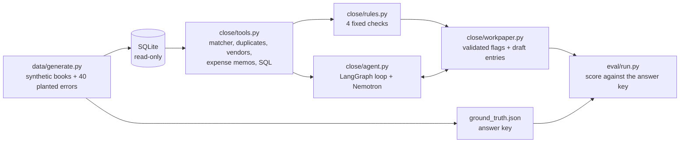

# Month-end close agent, with evals

[](https://github.com/rafayelmirijanyan1997/month-end-close-agent/actions/workflows/tests.yml)

**On 120 errors planted in three synthetic months of books, a rules engine plus an LLM agent (NVIDIA Nemotron 3.5 Super VL) found all 120, with no false alarms and a correct draft fix for every one, at about 72,000 tokens per close. Rules alone found 80%; the agent alone found 48%.**

The project automates the tedious part of an accountant's month-end close: reconciling the bank statement to the general ledger, finding what is wrong, and drafting the journal entry that fixes it. Because the errors are planted on purpose, every run can be scored against an exact answer key.

## Results

Seeds 42, 7 and 123, 40 planted errors each, one run per approach and seed ([eval/results.md](eval/results.md), raw numbers in [eval/rows.json](eval/rows.json)).

| approach | recall | precision | correct fixes | seconds per close | tokens per close |
|---|---|---|---|---|---|
| rules | 80% (96/120) | 100% (96/96) | 100% | 0.05 | 0 |
| agent alone | 48% (57/120) | 97% (58/60) | 85% | 104 | 736,582 |
| **rules + agent** | **100% (120/120)** | **100% (120/120)** | **100%** | 18 | 71,593 |

| approach | duplicate payment | missing deposit | transposed amount | wrong period (cut-off) | unapproved vendor |
|---|---|---|---|---|---|
| rules | 24/24 | 24/24 | 24/24 | **0/24** | 24/24 |
| agent alone | 24/24 | 8/24 | 13/24 | 8/24 | 4/24 |
| **rules + agent** | 24/24 | 24/24 | 24/24 | **24/24** | 24/24 |

**What the numbers say**

- **Rules are exact and consistent:** 32/40 on every seed, at no cost. They cannot judge cut-off, because that needs reading what a payment was for.
- **The agent alone is capable but unreliable.** The same code scored 31, 14 and 12 out of 40 on the three seeds, and an earlier single run on seed 42 scored 40/40. One good run proves little; that is why every number here comes from several seeds.
- **Rules + agent splits the work:** rules do the mechanical checks, then the agent continues the same workpaper with one narrow job, judgement. It found all 24 cut-off errors, finished on its own in 5 to 15 turns, and used about a tenth of the tokens of the agent alone.

## How it works



1. **Books** ([data/generate.py](data/generate.py)). One month (October 2026) for a small company from a fixed seed: 23 accounts, 44 vendors, about 2,950 balanced journal entries and a bank statement with realistic 1 to 3 day clearing delays and outstanding items. Money is stored in whole cents. Then 40 errors are planted, 8 of each type, and written to an answer key. Entry and bank ids are renumbered afterwards so a planted error cannot be spotted by its id, and the bank file never contains ledger ids.
2. **Tools** ([close/tools.py](close/tools.py)). Plain, tested Python functions shared by the rules and the agent: a one-to-one bank-to-ledger matcher, a duplicate finder (a SQL self-join), a vendor-master check, a summary of expense descriptions, and a read-only SQL tool.
3. **Rules** ([close/rules.py](close/rules.py)). Four fixed checks: unrecorded deposits, transpositions (a difference that is a multiple of 9 dollars), duplicates and unapproved vendors.
4. **Agent** ([close/agent.py](close/agent.py)). A LangGraph loop: the model chooses tools, the code runs them, and the results go back to the model. Each turn ends with a progress note kept by the code (turn count and errors already recorded), and old tool results are shortened so input stays small.
5. **Workpaper** ([close/workpaper.py](close/workpaper.py)). Every finding and draft entry is validated before it is saved, and the refusal message goes back to the model so it can correct itself.
6. **Evaluation** ([eval/run.py](eval/run.py)). Runs each approach on each seed and scores recall, precision, fix accuracy, time and tokens.

## Safety design

- The agent reads the books through a **read-only** SQLite connection. The SQL tool also accepts only `SELECT`, one statement at a time, and returns at most 50 rows.
- Every id in a finding must exist in the books, so a made-up id is refused.
- A draft entry must balance, use whole cents and real accounts. **Drafts are never posted:** a person reviews them.
- The answer key is never loaded into the database the agent can query.
- Payments to unapproved vendors are escalated, not "fixed".

## What I changed, and why: the improvement log

Each change came from reading the agent's trace, and each was measured afterwards (single runs on seed 42 until the three-seed evaluation).

| Problem found in the trace | Change | Effect |
|---|---|---|
| Model reasoning used all 4,096 output tokens; the loop ended after 2 turns | Thinking off by default; record each turn's `finish_reason` | Normal turns |
| Input grew about 6,500 tokens per turn (projected 5M per close) | Summarise outstanding items; shorten tool results older than the last 8 | about 3,500 per turn |
| 0 flags: after 13 turns of investigation, the reply that should have flagged everything was cut off | Retry a cut-off reply once; flag each error as soon as there is evidence | 8 flags |
| 35 of 40 turns spent paging through ledger deposits | Tool descriptions say what the matcher guarantees and how to query | 30/40 found, a third of the tokens |
| Fixes attached to the wrong errors: parallel calls get flag ids in completion order, and the model assumed call order | Record each error and its fix in one call | Correct fixes 7/22 to 22/23 |
| Paging again | A note when the same query shape repeats | One run: 40/40 |
| Three-seed eval: 14, 31 and 0 of 40; the agent re-flagged work it could no longer see | Progress note each turn | 44%, still inconsistent: run-to-run noise was larger than the effect of prompt changes |
| Stop tuning the agent alone | **Rules + agent** | 80%: the agent could not review 1,100 expense lines through a 50-row window, and its last turn's findings were discarded |
| | Expense-memo summary tool; last turn's tool calls are run | **100% on all three seeds** |

The detail is in the [commit history](https://github.com/rafayelmirijanyan1997/month-end-close-agent/commits/main).

## Limitations

- **Synthetic data.** Real books are confidential; planted errors give exact labels. Results on a real month would need validating first.
- **Cut-off is easier here than in real life.** A planted cut-off error says "Nov 2026 service" in its description. Real cut-off work means checking invoices and service dates.
- **Small sample:** three seeds, one run per approach and seed. Hosted models vary between runs even at temperature 0, so the agent-alone numbers in particular would move on a re-run.
- **The agent alone is not reliable enough to use.** The useful design is rules + agent.
- Cost figures are tokens on NVIDIA's hosted API (free developer access), not dollars.

## Run it yourself

```bash
python -m venv .venv && source .venv/bin/activate
pip install -r requirements.txt
cp .env.example .env               # add an NVIDIA API key with "Public API Endpoints" enabled

python -m pytest -q                # 59 tests; no API key needed
python -m eval.run --approaches rules            # rules only, seconds, no key
python -m eval.run --approaches rules+agent      # needs the key
python -m eval.run                 # all three approaches; the agent alone takes about 30 minutes
```

To close one month by hand: `python -m data.generate && python -m close.db && python -m close.agent`.

Model settings are in `.env`: `NVIDIA_MODEL` (default `nvidia/nemotron-3.5-super-vl-120b-a12b`) and `NVIDIA_THINKING`. `python -m close.check_model MODEL_ID` checks that a model can call tools.

## Project layout

```
data/generate.py      books, planted errors and answer key
close/db.py           loads the books into SQLite
close/tools.py        matcher, duplicates, vendors, expense memos, read-only SQL
close/workpaper.py    validated findings and draft entries
close/rules.py        rules baseline
close/agent.py        LangGraph agent, and rules + agent
close/llm.py          model settings
eval/run.py           evaluation harness
tests/                59 tests, including a rules regression eval run in CI
```

Built with Python, SQLite, pandas, LangGraph and NVIDIA Nemotron. MIT licence.
